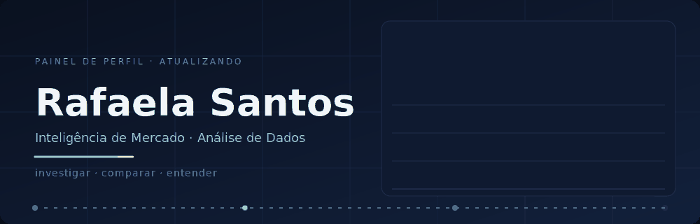

    

<em>Por trás de todo resultado existe a pergunta de sucesso.</em>

 

## Sobre mim

Estudo Inteligência de Mercado e Análise de Dados, e o que mais me prende nessa área é a parte que vem antes do gráfico: a pergunta. Gosto de abrir uma base, desconfiar do que parece óbvio e seguir os números até entender por que eles estão onde estão.

Me atrai encontrar padrões e tendências, e mais ainda descobrir o que eles sugerem sobre o próximo passo. Problemas difíceis me motivam, e aprender algo novo faz parte do meu jeito de trabalhar. Também acompanho com curiosidade como a inovação e a tecnologia estão mudando a forma de analisar informação.

Estou construindo meu caminho na área, e este espaço vai reunir o que eu desenvolver ao longo dele.

 

## Áreas de interesse

| | |
|---|---|
| **Análise de dados** | Investigar bases, testar hipóteses e entender o que os números realmente dizem. |
| **Inteligência de mercado** | Ler cenários, comportamentos e movimentos para apoiar decisões. |
| **Business Intelligence** | Organizar informação de forma clara para que ela possa ser acompanhada e discutida. |
| **Tendências e padrões** | Identificar o que se repete, o que muda e o que está começando a mudar. |
| **Indicadores** | Escolher e interpretar métricas que ajudem a explicar um resultado. |
| **Inovação** | Acompanhar novas ideias e tecnologias que influenciam a forma de analisar dados. |

 

## Projetos

| Projeto | Descrição |
|---|---|
| [**Produção agrícola municipal: soja e milho (2021–2025)**](https://1drv.ms/x/c/9057af74277147fe/IQAVlFPxuWBHRqlD32CbXDfDAbMlLHDjYA-I-TCf7cCbsds?e=S2dfEm) | Análise da produção municipal dessas duas culturas ao longo do período. |

 

## Contato

- **LinkedIn:** [linkedin.com/in/rafaela-santos-udimg](https://www.linkedin.com/in/rafaela-santos-udimg)
- **E-mail:** [Rafaelaribeiro1078@gmail.com](mailto:Rafaelaribeiro1078@gmail.com)

<!--
**Rafaelasants/Rafaelasants** is a ✨ _special_ ✨ repository because its `README.md` (this file) appears on your GitHub profile.

Here are some ideas to get you started:

- 🔭 I’m currently working on ...
- 🌱 I’m currently learning ...
- 👯 I’m looking to collaborate on ...
- 🤔 I’m looking for help with ...
- 💬 Ask me about ...
- 📫 How to reach me: ...
- 😄 Pronouns: ...
- ⚡ Fun fact: ...
-->
